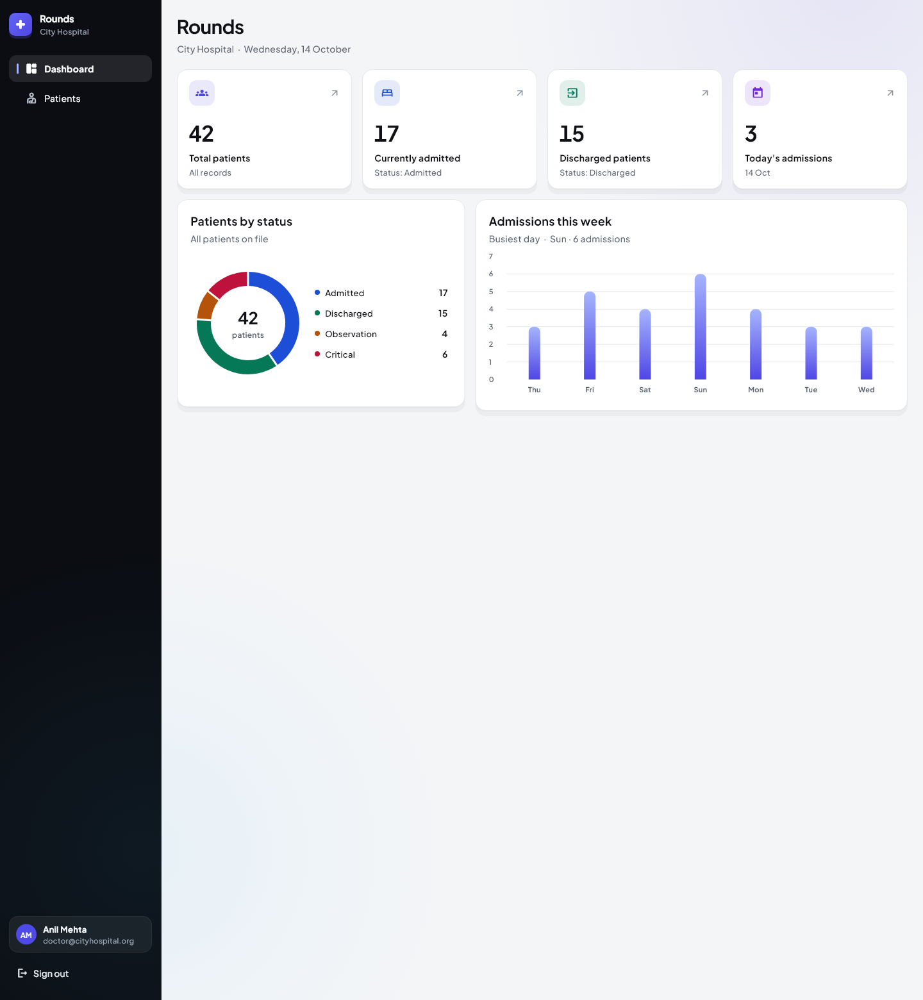
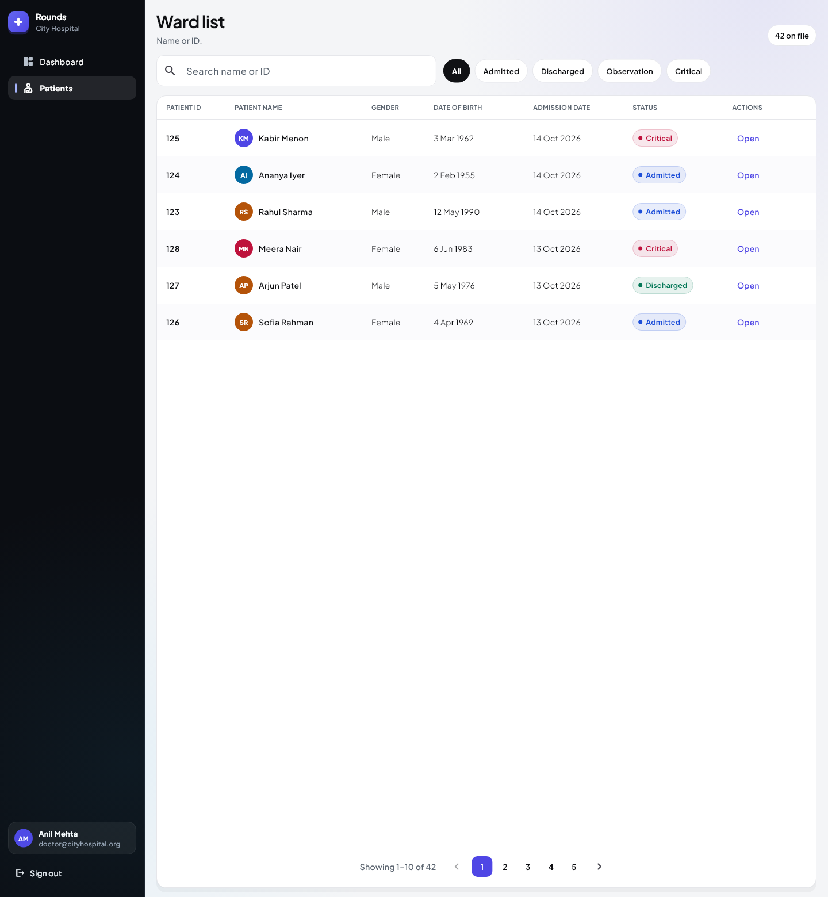

# Rounds

Flutter web app for City Hospital. Staff sign in, check today's admissions, and open a patient from the ward list.

The Flutter project is this `hospital_dashboard` folder. The Android project in the parent folder is separate.

Live: https://web-five-mauve-71.vercel.app

## Screenshots





## Setup and run

You need Flutter 3.47 or newer, with web enabled, and Chrome or Edge.

```bash
cd hospital_dashboard
flutter pub get
flutter run -d chrome
```

To serve it without opening a browser:

```bash
flutter run -d web-server --web-port 8090 --web-hostname 127.0.0.1
```

Then open `http://127.0.0.1:8090`.

### Test account

| Field | Value |
| --- | --- |
| Email | `doctor@cityhospital.org` |
| Password | `Ward1234` |

The login screen has a Fill button for these. Any other email or password is rejected after the format checks.

The session is stored with `shared_preferences`. A refresh keeps you signed in. Sign out clears it.

## What it does

- Login with email and password. Empty, badly formatted, and wrong credentials show an error.
- Dashboard is titled Rounds. Cards: total patients, currently admitted, discharged, and today's admissions. A donut shows status counts and a bar chart shows the last 7 days.
- Ward list: ID, name, gender, date of birth, admission date, status, and Open. Search by name or ID. Status is a row of chips (All, Admitted, Discharged, Observation, Critical). 10 rows per page. The count on the right is how many records match.
- Patient details at `/patients/123` (Rahul Sharma). Refresh, back, and forward keep the route. List filters are in the query string (`q`, `status`, `page`).
- Desktop uses a sidebar and a table. Tablet uses an icon rail. Phone uses a drawer and cards, so the page does not scroll sideways.

Loading, empty, and error states are included. To force the error state:

```bash
flutter run -d chrome --dart-define=SIMULATE_API_ERROR=true
```

## Structure

State is Riverpod.

- `AuthController` is a `Notifier`. It restores the session, signs in, and signs out. The router listens to it for redirects.
- The dashboard, the list, and the details page use `FutureProvider`. Widgets only handle loading, data, and error.
- Search, status, and page live in the URL, so refresh and browser history do not need a second copy of that state.

```
lib/
  main.dart, app.dart
  config/          dart-define values
  theme/
  routing/         go_router and redirect rules
  common/          dates, breakpoints, shared widgets
  features/
    auth/          repository, controller, login, boot
    dashboard/     stats and dashboard screen
    patients/      models, repositories, list, details
```

Each feature keeps domain types, data access, and screens apart. Screens talk to `PatientRepository` only. `MockPatientRepository` is the default. `RemotePatientRepository` calls `GET /api/v1/patients?page=&page_size=` and then filters and looks up a patient locally, because the contract does not define search or a details route.

`AppConfig` reads `--dart-define`:

| Define | Default | Purpose |
| --- | --- | --- |
| `USE_MOCK_API` | `true` | `false` uses the HTTP repository |
| `API_BASE_URL` | `https://api.cityhospital.org` | Origin for `/api/v1/...` |
| `SIMULATE_API_ERROR` | `false` | Makes the mock repository fail |

Against a real API:

```bash
flutter run -d chrome \
  --dart-define=USE_MOCK_API=false \
  --dart-define=API_BASE_URL=https://api.example.com
```

Routes are path URLs (`/dashboard`, `/patients`, `/patients/123`), not hash URLs. The browser tab title is `Rounds — City Hospital`.

## Build and deploy

```bash
flutter build web --release
```

Output is `build/web`. Host that folder on any static server. Unknown paths such as `/patients/123` must fall back to `index.html`. `web/vercel.json` does that for Vercel and is copied into the build.

```nginx
location / {
  try_files $uri $uri/ /index.html;
}
```

The production site is https://web-five-mauve-71.vercel.app. A new release is `flutter build web --release`, then deploy the `build/web` folder.

If the site is not at the domain root:

```bash
flutter build web --release --base-href /hospital/
```

`--dart-define` values are compiled in. Pass them at build time, not from a runtime env file.

```bash
flutter build web --release \
  --dart-define=USE_MOCK_API=false \
  --dart-define=API_BASE_URL=https://api.example.com
```

## Tests

```bash
flutter test
```

Covers the JSON parser, paging, search, status filters, dashboard totals, login checks, and the redirect rules.

## Assumptions

- There is no backend, so the app ships with 42 mock patients and a separate HTTP client.
- "Currently admitted" is status `Admitted` only. Observation and Critical show on the status chart, not on that card.
- Dashboard numbers come from the patient list. There is no stats endpoint.
- Search and status are applied in the repository. If the live API only supports `page` and `page_size`, the remote client downloads pages (10 rows, up to 40 pages) and filters them locally.
- Patient 123 is Rahul Sharma, male, born 12 May 1990. Mock admission dates are relative to today so "today" and the week chart stay filled.
- The sidebar shows Anil Mehta as the signed-in doctor. The test password is only for this demo.
- Dates use `en_US`.

## Limitations

- No create, edit, discharge, or delete.
- No roles, password reset, or a second factor.
- The remote client stops at 400 patients and does not send search to the server.
- Phone, ward, and diagnosis are filled by the mock. A short API payload shows "Not recorded" for missing fields.
- No live bed board, notifications, or audit log.
